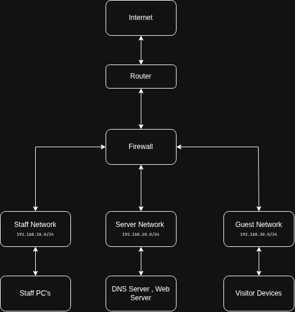

# Office Network Infrastructure Lab

A simulated private office network built using Docker Compose. It separates staff, server, and guest networks using subnetting and controls communication through a Linux firewall using iptables.


## Network Architecture




## Network Segments

| Network | Subnet | Devices |
|---|---|---|
| Staff | 192.168.10.0/24 | PC1, PC2 |
| Servers | 192.168.20.0/24 | DNS, Web |
| Guest | 192.168.30.0/24 | Guest1 |
| Uplink | 192.168.99.0/24 | Router, Firewall |


## Key Features

- **Network segmentation:** Four isolated networks (staff, servers, guest, uplink), each on its own subnet, modeled on a small office.
- **Default-deny firewall:** A dedicated firewall container with `iptables`, where all forwarded traffic is dropped unless a rule explicitly allows it. Return traffic is allowed through connection tracking.
- **Role-based access policy:**
  - Staff can reach internal servers but have no direct internet access.
  - Guests can reach the internet only, and are blocked from every private (`192.168.0.0/16`) network.
  - Servers cannot initiate connections into the staff network.
- **Edge router with NAT:** A router container connects the lab to the outside world and masquerades internal addresses for internet access.
- **Internal DNS:** A `dnsmasq` server resolves internal names such as `web.office.lan` and `intranet.office.lan`, so staff use names instead of IP addresses.
- **Internal web server:** An nginx container serves an intranet page from a bind-mounted folder, so editing the file updates the site with no rebuild.
- **Built-in troubleshooting tools:** Every machine includes `ping`, `traceroute`, `tcpdump`, `dig` and `curl` for diagnosing connectivity.


## Deployment

### Requirements

- Docker and Docker Compose
- Internet access for the first build (to download packages)

### Steps

1. **Clone the repository**
   ```bash
   git clone https://github.com/yogu-code/office-network.git
   cd office-network
   ```

2. **Build the base image**
   ```bash
   docker build -t officepc .
   ```

3. **Start the lab**
   ```bash
   docker compose up -d --build
   ```

4. **Check that all containers are running**
   ```bash
   docker ps
   ```
   You should see 7 containers: `router`, `firewall`, `pc1`, `pc2`, `guest1`, `web` and `dns`.

### Test the network

```bash
docker exec pc1 curl http://web.office.lan      # works: staff can reach the website
docker exec guest1 ping -c 2 1.1.1.1            # works: guest can reach the internet
docker exec pc1 ping -c 2 -W 2 1.1.1.1          # fails: staff have no internet access
docker exec guest1 ping -c 2 -W 2 192.168.10.11 # fails: guest cannot reach staff
```

### Update the website

Edit `site/index.html`. The change shows up immediately, with no restart needed.

### Stop the lab

```bash
docker compose down
```

## Conclusion

This project simulates a small office network using Docker. It has separate staff, server and guest zones, a default-deny firewall, a router with NAT, internal DNS and an intranet website, all defined in one `docker-compose.yml`.

Building it gave me hands-on practice with subnetting, routing, firewall rules, DNS and troubleshooting connectivity problems.